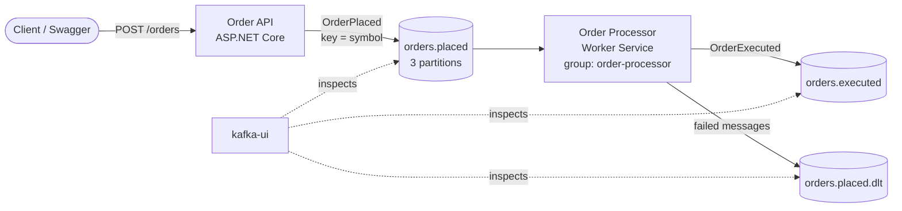
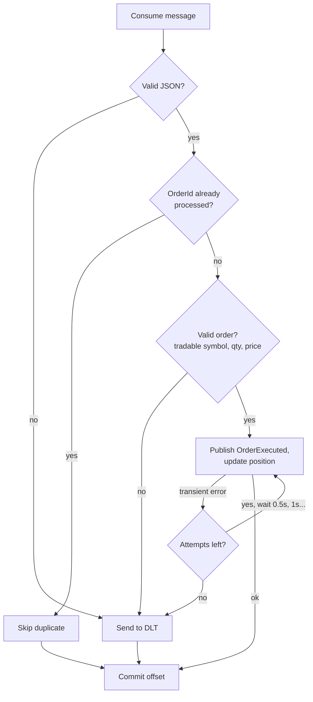

# Trading Kafka Demo

[](https://github.com/igiadas/trading-kafka-demo/actions/workflows/ci.yml)

A small, personal learning project: an event-driven order flow for equity trading, built with
**.NET 8** and **Apache Kafka** using the plain [`Confluent.Kafka`](https://github.com/confluentinc/confluent-kafka-dotnet)
client (no MassTransit or other abstraction on top, so every Kafka concept is visible in the code).

- An **API** receives buy/sell orders and publishes them as `OrderPlaced` events.
- A **worker** consumes them, keeps a net position per stock, and publishes `OrderExecuted` events.
- Failures are handled explicitly: manual offset commits, idempotent processing, retries with backoff and a dead-letter topic.

The order "execution" is simulated. The point of the project is the messaging, not the trading logic.

## Architecture



What happens to one message in the worker:



| Project | What it is |
|---|---|
| [`src/Trading.Contracts`](src/Trading.Contracts) | Events, topic names and JSON settings shared by both services |
| [`src/Trading.OrderApi`](src/Trading.OrderApi) | Minimal API, the Kafka **producer** |
| [`src/Trading.OrderProcessor`](src/Trading.OrderProcessor) | Worker Service, the Kafka **consumer**. `Processing/` is business logic, `Kafka/` is everything Kafka-specific |
| [`tests/Trading.Tests`](tests/Trading.Tests) | xUnit + FluentAssertions + Moq |

## Running it

Requirements: Docker. (.NET 8 SDK only if you want to run the tests or the services outside Docker.)

```bash
docker compose up --build
```

| URL | |
|---|---|
| http://localhost:5080/swagger | API (Swagger UI) |
| http://localhost:8080 | kafka-ui: topics, messages, consumer groups |

### Try it

```bash
# A normal order -> processed, appears in orders.executed
curl -X POST http://localhost:5080/orders -H "Content-Type: application/json" \
  -d '{"symbol":"SAN","side":"Buy","quantity":100,"price":4.25}'

# The same OrderId twice -> the second one is skipped as a duplicate (see the worker logs)
curl -X POST http://localhost:5080/orders -H "Content-Type: application/json" \
  -d '{"symbol":"ITX","side":"Buy","quantity":10,"price":48.10,"orderId":"11111111-1111-1111-1111-111111111111"}'

# Unknown symbol -> the API accepts it, the worker rejects it -> orders.placed.dlt
curl -X POST http://localhost:5080/orders -H "Content-Type: application/json" \
  -d '{"symbol":"XYZ","side":"Buy","quantity":5,"price":1.00}'
```

To send a malformed message, open kafka-ui, go to **Topics → orders.placed → Produce Message** and send
any value that is not valid JSON: it goes straight to `orders.placed.dlt`. Open a DLT message in kafka-ui
and look at its **Headers**: original topic, partition, offset, exception and number of attempts.

Watch the worker:

```bash
docker compose logs -f order-processor
```

See the consumer group share the partitions between instances (watch the "Partitions assigned" lines):

```bash
docker compose up -d --scale order-processor=3
```

Stop and remove everything (Kafka data is not persisted, so the next `up` starts with empty topics):

```bash
docker compose down
```

### Tests

```bash
dotnet test
```

The tests cover the processing logic (positions, duplicates, validation, safe retries), the retry/DLT
decisions and the DLT message format. The Kafka loop itself is checked by running the stack above.

### Running the services outside Docker

Start only Kafka (and the UI) with `docker compose up kafka kafka-init kafka-ui`, then
`dotnet run --project src/Trading.OrderApi` and `dotnet run --project src/Trading.OrderProcessor`.
Both use `localhost:9092` by default.

## Kafka concepts, and where they are in the code

**Topic.** A named, append-only log of messages. There are three, created by the `kafka-init` service in
[`docker-compose.yml`](docker-compose.yml) (auto-creation is disabled), and named in
[`Topics.cs`](src/Trading.Contracts/Topics.cs).

**Partition.** Each topic is split into 3 partitions. Partitions are the unit of parallelism: within a
consumer group, one partition is read by one consumer only. Ordering is guaranteed **within a partition**,
not across the topic.

**Key.** Kafka picks the partition by hashing the message key. The API uses the stock symbol as the key
([`KafkaOrderPublisher.cs`](src/Trading.OrderApi/KafkaOrderPublisher.cs)), so all orders for `SAN` go to
the same partition and are processed in the order they were sent. That is why
[`PositionBook`](src/Trading.OrderProcessor/Processing/PositionBook.cs) needs no locking.

**Consumer group.** All worker instances share the `GroupId` `order-processor`
([`appsettings.json`](src/Trading.OrderProcessor/appsettings.json)). Kafka divides the partitions among
them and moves them when an instance joins or leaves (a *rebalance*, logged by the handlers in
[`OrderConsumerWorker.cs`](src/Trading.OrderProcessor/Kafka/OrderConsumerWorker.cs)). More instances
than partitions means idle instances.

**Offset.** The position of a message in a partition. The group *commits* the offset it has finished
with, so a restarted consumer continues from there. `EnableAutoCommit = false`, and
`consumer.Commit(result)` is called only **after** the message is fully handled
([`OrderConsumerWorker.cs`](src/Trading.OrderProcessor/Kafka/OrderConsumerWorker.cs)).
`AutoOffsetReset = Earliest` decides where a group with no committed offset starts.

**Delivery guarantees.**
- *At-most-once*: commit before processing. A crash loses the message.
- *At-least-once* (this project): commit after processing. A crash between processing and commit
  means the message is delivered again, so duplicates are possible and must be handled.
- *Exactly-once*: Kafka transactions (`read-process-write` with `SendOffsetsToTransaction`). Only covers
  Kafka-to-Kafka; any external side effect (a database, an email) still needs idempotency.

On the producer side, `Acks = All` waits for all in-sync replicas, and `EnableIdempotence = true` stops the
producer's own retries from writing duplicates ([`Program.cs`](src/Trading.OrderApi/Program.cs)).

**Idempotent consumer.** Because delivery is at-least-once, the worker remembers processed `OrderId`s and
skips repeats ([`OrderProcessor.cs`](src/Trading.OrderProcessor/Processing/OrderProcessor.cs),
[`ProcessedOrderStore.cs`](src/Trading.OrderProcessor/Processing/ProcessedOrderStore.cs)). The order of
steps matters: the only call that can fail (publishing `OrderExecuted`) runs **before** any local state
changes, so a failed attempt can be retried safely.

**Retries with backoff.** Unexpected errors are treated as transient: up to 3 attempts in total, waiting
0.5 s, then 1 s ([`OrderMessageHandler.cs`](src/Trading.OrderProcessor/Kafka/OrderMessageHandler.cs),
[`RetryOptions.cs`](src/Trading.OrderProcessor/Kafka/RetryOptions.cs)). Errors that a retry can never fix
(malformed JSON, `InvalidOrderException`) skip the retries.

**Dead-letter topic (DLT).** A message that cannot be processed is copied unchanged to `orders.placed.dlt`
with headers explaining the failure ([`KafkaDeadLetterPublisher.cs`](src/Trading.OrderProcessor/Kafka/KafkaDeadLetterPublisher.cs)),
and its offset is committed. One bad message (a *poison message*) does not block the partition, and
nothing is lost silently. If even the DLT cannot be written, the worker stops **without** committing, so
the message is consumed again after the restart.

## Simplifications (deliberate, and what production would do)

- **In-memory state.** Positions and processed `OrderId`s live in memory: lost on restart, and not shared
  between instances (after a rebalance, the new owner of a partition starts with an empty position).
  Production: a database, with the position update and the processed-id insert in one transaction,
  or Kafka Streams state stores.
- **One message at a time** with a synchronous commit per message: simple and easy to reason about,
  not the fastest. Faster options: commit in batches, or `StoreOffset` with auto-commit.
- **In-place retries block the partition** while waiting. Fine for short waits (they must stay well under
  `max.poll.interval.ms`); for long ones, use separate retry topics.
- **JSON values without a schema.** Production usually uses a Schema Registry with Avro or Protobuf.
- **Default (eager) rebalancing**: every instance gives up all its partitions on each rebalance. The
  cooperative-sticky assignor avoids that.
- **Single broker, replication factor 1, plaintext**: a demo setup. Production uses at least 3 brokers,
  `min.insync.replicas = 2`, TLS and authentication.
