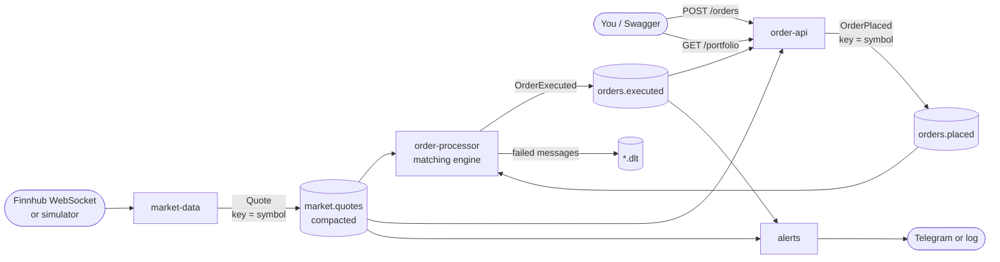

# Kotiz

[](https://github.com/igiadas/kotiz/actions/workflows/ci.yml)

**Paper trading with real market prices.** Practise a strategy or watch a portfolio against live
prices without risking money: place market, limit and stop orders, see positions and P&L update
with every price, and get a Telegram message when a stop-loss is hit or a price moves sharply.

It is also a personal project to learn event-driven design properly: **.NET 8** services talking
through **Apache Kafka**, using the plain [`Confluent.Kafka`](https://github.com/confluentinc/confluent-kafka-dotnet)
client (no MassTransit or other abstraction), so every Kafka concept is visible in the code.

> Paper trading only: no real orders are sent anywhere, and fills are simplified (see the end of this page).

## Architecture



| Service | Consumer group | Reads | Writes |
|---|---|---|---|
| [`market-data`](src/Kotiz.MarketData) | (producer only) | Finnhub or simulator | `market.quotes` |
| [`order-api`](src/Kotiz.OrderApi) | a new one on every start | `orders.executed`, `market.quotes` (from the beginning) | `orders.placed` |
| [`order-processor`](src/Kotiz.OrderProcessor) | `order-processor` | `orders.placed`, `market.quotes` | `orders.executed`, `*.dlt` |
| [`alerts`](src/Kotiz.Alerts) | `alerts` | `orders.executed`, `market.quotes` | Telegram |

[`Kotiz.Contracts`](src/Kotiz.Contracts) holds the events and topic names shared by all of them;
[`tests/Kotiz.Tests`](tests/Kotiz.Tests) uses xUnit, FluentAssertions and Moq.

### Why Kafka fits here

Prices are a continuous stream of events, and several parts of the system need the **same** stream
for **different** reasons: the matching engine to fill orders, the portfolio to value positions, the
alerts service to spot sharp moves. With Kafka each one is an independent consumer group with its own
position in the log, its own pace and its own delivery guarantees, and adding a fourth consumer needs no
change to the others. Because the log is kept, the API can rebuild the whole portfolio by reading it
again from the beginning, and a service that was down simply catches up.

## Running it

Requirements: Docker. (.NET 8 SDK only to run the tests or the services outside Docker.)

```bash
docker compose up --build
```

That is all: with no configuration, prices are **simulated** and alerts are **written to the log**.

| URL | |
|---|---|
| http://localhost:5080/swagger | API (Swagger UI) |
| http://localhost:8080 | kafka-ui: topics, messages, consumer groups |

### Try it

```bash
# Current prices
curl http://localhost:5080/prices

# Market order: fills at the latest price
curl -X POST http://localhost:5080/orders -H "Content-Type: application/json" \
  -d '{"symbol":"AAPL","side":"Buy","quantity":10}'

# Stop-loss: sells if the price falls to 220 (adjust it to the current price)
curl -X POST http://localhost:5080/orders -H "Content-Type: application/json" \
  -d '{"symbol":"AAPL","side":"Sell","quantity":10,"type":"Stop","price":220}'

# Take profit: sells if the price rises to 250
curl -X POST http://localhost:5080/orders -H "Content-Type: application/json" \
  -d '{"symbol":"AAPL","side":"Sell","quantity":10,"type":"Limit","price":250}'

# Positions, average price, realized and unrealized P&L
curl http://localhost:5080/portfolio
```

```bash
docker compose logs -f order-processor alerts
```

Failure paths:
- An unknown symbol (`"symbol":"XYZ"`) is accepted by the API but rejected by the processor: it lands in
  `orders.placed.dlt`. Open it in kafka-ui and look at the message **Headers** (original topic, partition,
  offset, error, attempts).
- Sending the same `orderId` twice: the second one is skipped as a duplicate (see the processor log).
- Any non-JSON value produced to `orders.placed` from kafka-ui (**Produce Message**) goes straight to the DLT.

Scale the processor and watch the group split the partitions ("Partitions assigned" in the log):

```bash
docker compose up -d --scale order-processor=3
```

Stop with `docker compose stop` (keeps the data) or `docker compose down` (deletes everything).

### Real prices (Finnhub)

1. Create a free account at [finnhub.io/register](https://finnhub.io/register) and copy the API key from the dashboard.
2. `cp .env.example .env` and set:
   ```
   MARKET_DATA_SOURCE=Finnhub
   FINNHUB_API_KEY=your-key
   SYMBOLS=AAPL,MSFT,NVDA,BINANCE:BTCUSDT
   ```
3. `docker compose up -d --build`

Why Finnhub: the free plan streams real-time trades over a WebSocket for **US stocks and crypto**, and only
needs one API key. Neither Finnhub nor Alpaca (the other free option considered) covers the Spanish market
for free, so the examples use US symbols. Crypto (`BINANCE:BTCUSDT`) trades 24/7, which is handy outside US
market hours (15:30–22:00 CET). Alpaca's free IEX feed gives real bid/ask quotes, but needs a key and a
secret and only covers US stocks. Finnhub sends the **last traded price**, not bid/ask, and Kotiz fills
orders at that price.

### Telegram alerts (optional)

1. In Telegram, talk to [@BotFather](https://t.me/BotFather), send `/newbot` and copy the token.
2. Send any message to your new bot, then open `https://api.telegram.org/bot<TOKEN>/getUpdates`
   and copy `message.chat.id`.
3. Set `TELEGRAM_BOT_TOKEN` and `TELEGRAM_CHAT_ID` in `.env` and restart: `docker compose up -d alerts`.

Keys only live in `.env` (ignored by git) or environment variables. Never commit them.

### Tests and running outside Docker

```bash
dotnet test
```

Tests cover the matching rules, the P&L math, idempotency, the retry/DLT decisions, the sharp-move
detector and the Finnhub message parser. The Kafka loops themselves are checked by running the stack.

To run a service from your IDE, start the infrastructure with `docker compose up kafka kafka-init kafka-ui`
and `dotnet run --project src/Kotiz.<Service>`: everything uses `localhost:9092` by default. For the
Finnhub key, use `dotnet user-secrets set "Market:FinnhubApiKey" "<key>" --project src/Kotiz.MarketData`.

## Kafka concepts, and where they are in the code

**Topic.** A named, append-only log of messages, created by the `kafka-init` service in
[`docker-compose.yml`](docker-compose.yml) (auto-creation is disabled) and named in
[`Topics.cs`](src/Kotiz.Contracts/Topics.cs).

**Partition.** Each topic has 3 partitions: the unit of parallelism (one partition is read by one consumer
of a group) and of ordering (guaranteed **within a partition**, not across the topic).

**Key.** The partition is picked by hashing the key. Orders and prices both use the symbol
([`KafkaOrderPublisher.cs`](src/Kotiz.OrderApi/KafkaOrderPublisher.cs),
[`QuotePublisherWorker.cs`](src/Kotiz.MarketData/QuotePublisherWorker.cs)), so all of AAPL's orders are in
order, in one partition.

**Co-partitioning.** `orders.placed` and `market.quotes` have the same number of partitions, the same key and
the same partitioner (both producers use librdkafka's default), so AAPL is in the same partition number in both. The processor subscribes to both with the *range* assignor,
which gives partition N of every topic to the same consumer: an order and the prices that fill it always
meet in the same instance, with no shared state ([`OrderConsumerWorker.cs`](src/Kotiz.OrderProcessor/Kafka/OrderConsumerWorker.cs),
[`MatchingEngine.cs`](src/Kotiz.OrderProcessor/Processing/MatchingEngine.cs)).

**Consumer groups.** Three groups read the same topics independently (table above). Within the
`order-processor` group, instances share the partitions and Kafka moves them when one joins or leaves
(a *rebalance*, logged by the handlers in `OrderConsumerWorker.cs`).

**Offsets and delivery guarantees.** Each service chooses what it needs:
- `order-processor`: **at-least-once**. `EnableAutoCommit = false` and `consumer.Commit(result)` only after
  the message is fully handled. A crash in between means the message is delivered again.
- `alerts`: auto-commit and `AutoOffsetReset = Latest` ([`AlertsWorker.cs`](src/Kotiz.Alerts/AlertsWorker.cs)).
  An alert may rarely be lost or repeated, and alerts about the past are useless.
- `order-api`: commits nothing; a fresh group on every start re-reads everything
  ([`PortfolioProjectionWorker.cs`](src/Kotiz.OrderApi/Portfolio/PortfolioProjectionWorker.cs)).
- Exactly-once would need Kafka transactions, and only covers Kafka-to-Kafka; external effects still need idempotency.

**Producer settings.** `Acks = All` plus `EnableIdempotence = true` for orders, awaiting each
`ProduceAsync` ([`Program.cs`](src/Kotiz.OrderApi/Program.cs)). Prices use fire-and-forget `Produce` with a
delivery callback: a lost price is replaced a second later, a lost order is not.

**Idempotent consumers.** The processor skips an `OrderId` it has already seen
([`OrderProcessor.cs`](src/Kotiz.OrderProcessor/Processing/OrderProcessor.cs)), and so does the portfolio
([`PortfolioState.cs`](src/Kotiz.OrderApi/Portfolio/PortfolioState.cs)). The processor always publishes first
and changes state after: a pending order leaves the book only once its execution is in Kafka, so a retried
price never fills an order twice.

**Retries, backoff and dead-letter topics.** Unexpected errors are retried (3 attempts in total, waiting 0.5 s
then 1 s); errors no retry can fix (bad JSON, invalid order) are not
([`OrderMessageHandler.cs`](src/Kotiz.OrderProcessor/Kafka/OrderMessageHandler.cs)). A message that cannot be
processed is copied to `<topic>.dlt` with headers explaining why
([`KafkaDeadLetterPublisher.cs`](src/Kotiz.OrderProcessor/Kafka/KafkaDeadLetterPublisher.cs)) and its offset is
committed, so one bad message never blocks a partition. If even the DLT cannot be written, the processor stops
**without** committing and the message is read again after the restart.

**Log compaction.** `market.quotes` is compacted: Kafka keeps at least the latest message per key, so it never
grows without limit and any new consumer can learn the last price of every symbol by reading it from the start.

**Projection (read model).** The portfolio is never written directly: it is derived from `orders.executed`
and `market.quotes`. The event log is the source of truth.

## Simplifications (deliberate, and what production would do)

- **Fills.** Orders fill completely at the last traded price, with no bid/ask spread, partial fills or
  liquidity. A stop fills at the first price at or past the stop (so below it on a gap down, as in a real market).
- **Pending orders live in memory** in the processor: a restart loses open limit/stop orders. Production: a
  compacted `orders.open` topic or a database, rebuilt on startup. The same applies to the processed-ids set.
- **Positions and P&L** are recomputed by the API on each start, which is fine for one user's history; a
  large history would use snapshots.
- **One message at a time** with a synchronous commit per message: simple, not the fastest.
- **In-place retries block the partition** while waiting; long waits would need retry topics.
- **JSON without a schema.** Production usually uses a Schema Registry with Avro or Protobuf.
- **Single broker, replication factor 1, plaintext.** Production: at least 3 brokers,
  `min.insync.replicas = 2`, TLS and authentication.
